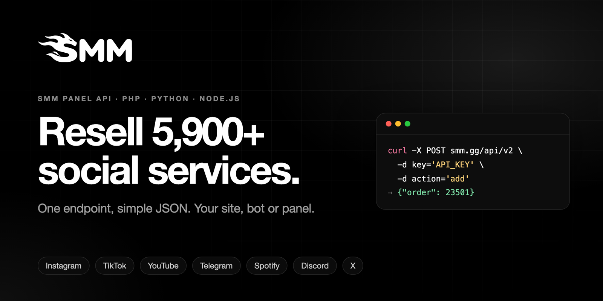
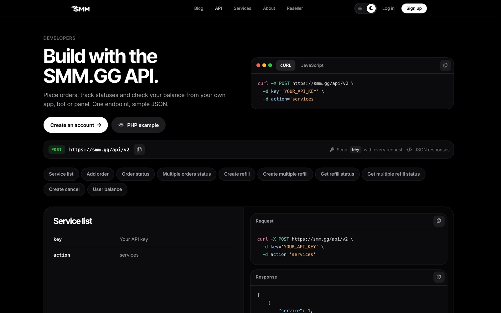
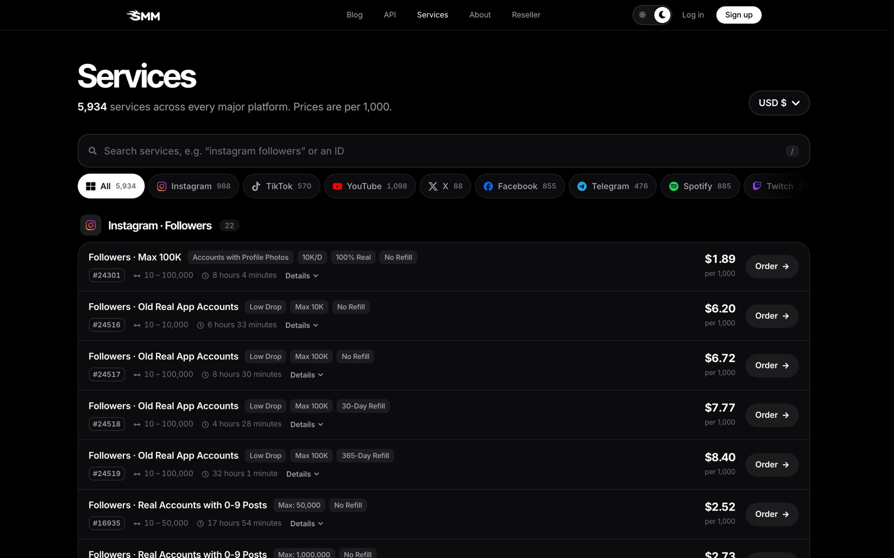

<div align="center">

<a href="https://smm.gg"></a>

<br><br>

# SMM Panel API · PHP, Python & Node.js

**The official [SMM.GG](https://smm.gg) SMM panel API client.** Resell 5,900+ social media services from your own website, bot, reseller panel or your own panel.

<br>

[](https://smm.gg)
[](https://smm.gg/api)
[](https://smm.gg/services)
[](https://smm.gg/smm-panel-for-resellers)


</div>

<br>

<table>
<tr>
<td width="50%"><a href="https://smm.gg"></a></td>
<td width="50%"><a href="https://smm.gg/api"></a></td>
</tr>
<tr>
<td align="center"><sub><b>SMM panel</b> · followers, views and likes for every platform</sub></td>
<td align="center"><sub><b>API docs</b> · one endpoint, simple JSON</sub></td>
</tr>
</table>

## Why SMM.GG

| | |
|---|---|
| 🌍 **5,900+ services** | Instagram, TikTok, YouTube, Telegram, Spotify, Discord, X, Facebook, Twitch and more |
| ⚡ **Standard v2 API** | Works with most SMM panel scripts: paste the URL and your key |
| 🔁 **Refills & cancels** | Supported per service, straight from the API |
| 💳 **Card or crypto** | One USD balance for the panel and the API |
| 🏷️ **Your own panel** | Run your own branded SMM panel on your domain |
| 💬 **24/7 support** | Ticket support in 20 languages, around the clock |

## Getting started

Official examples for the [SMM.GG](https://smm.gg) **SMM panel API**. Use it to resell 5,900+ social media services (Instagram, TikTok, YouTube, Telegram, Spotify, Discord, X and more) from your own site, bot or panel.

- Endpoint: `https://smm.gg/api/v2` (HTTP POST, form fields, JSON response)
- Get your API key: sign up at [smm.gg](https://smm.gg/signup), then open [smm.gg/account](https://smm.gg/account)
- Full reference: [smm.gg/api](https://smm.gg/api)
- Reseller info: [smm.gg/smm-panel-for-resellers](https://smm.gg/smm-panel-for-resellers)

## Actions

| Action | Fields | Returns |
|---|---|---|
| `services` | `key` | Service list with id, name, rate, min, max, category, refill, cancel |
| `add` | `key`, `service`, `link`, `quantity` (+ `runs`, `interval`, `comments`… per service type) | `{"order": 23501}` |
| `status` | `key`, `order` (or `orders` = up to 100 ids, comma separated) | charge, start_count, status, remains, currency |
| `refill` | `key`, `order` (or `orders`) | `{"refill": "1"}` |
| `refill_status` | `key`, `refill` (or `refills`) | refill status |
| `cancel` | `key`, `orders` | per-order result |
| `balance` | `key` | `{"balance": "100.84", "currency": "USD"}` |

## Quick start

```bash
curl -X POST https://smm.gg/api/v2 -d "key=YOUR_API_KEY" -d "action=balance"
```

| Language | File |
|---|---|
| PHP | [`php/SmmGG.php`](php/SmmGG.php) |
| Python | [`python/smmgg.py`](python/smmgg.py) |
| Node.js | [`node/smmgg.js`](node/smmgg.js) |

Keep your API key secret: load it from an environment variable (`SMMGG_API_KEY`), never commit it.

## What is an SMM panel API?

An SMM panel API lets your own website, Telegram/Discord bot or reseller panel place and track orders on an SMM panel automatically. You send a link and a quantity, the panel delivers followers, likes, views or members, and you poll the order status. SMM.GG uses the standard v2 format most SMM panel scripts already support, so you can usually connect it as a provider by pasting the URL and your key.

<p align="center"><a href="https://smm.gg/services"></a><br><sub>Live <a href="https://smm.gg/services">services and prices</a>, per 1,000, in USD</sub></p>

## Use cases

- **SMM reseller panel:** list SMM.GG services on your own panel and resell them at your price.
- **Your own panel:** open your own branded SMM panel from your SMM.GG account (*Your own panel* after sign-in), add your domain and point it as shown on that page.
- **SMM panel script / custom site:** call the API from your own PHP, Python or Node.js code with the clients in this repo.
- **Bots and automation:** auto-order views or likes for new posts, check balances, request refills.

## FAQ

**Do I need a separate balance for the API?** No. API orders use your normal SMM.GG balance; top up by card or crypto.

**Does the API support refills and cancels?** Yes, for services marked with refill or cancel in the `services` response.

**Can I check many orders at once?** Yes, `status` with `orders` accepts up to 100 order IDs.

**Which currency is used?** Prices and balances are in USD.

## Related

- [SMM panel Telegram bot](https://github.com/smm-gg/smm-panel-telegram-bot): order and track services from Telegram with this API.

## Support

Questions about the API or an order: open a ticket at [smm.gg/tickets](https://smm.gg/tickets) (24/7).

<br>

<div align="center">

**[Create a free account →](https://smm.gg/signup)**

<sub>SMM panel API · cheap SMM panel · SMM reseller panel · your own SMM panel · Instagram, TikTok, YouTube & Telegram services · MIT licensed</sub>

</div>
